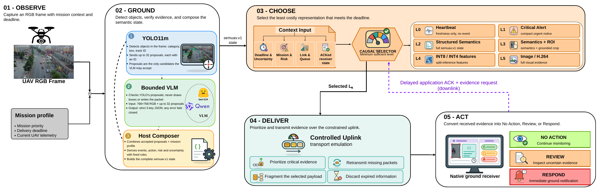

# SemUAV-VLM

**Mission-conditioned semantic communication for UAV visual uplinks.**

SemUAV-VLM turns every UAV camera frame into the *least costly message that still lets
the ground station take the right action on time*. On board, a detector grounds the
frame in a verifiable semantic state (`semuav.v1`). A causal selector then picks one of
six representation levels, from a 1 kB alert to the full image. A deadline-aware
transport layer delivers it over a constrained uplink, and a native ground receiver
turns it into NO ACTION, REVIEW, or RESPOND.



This repository contains the complete, pre-registered study code for the paper:

> M. Al Juboori, T. Almazrouei, F. Ullah, H. El-Sayed and M. Ur Rehman, "SemUAV-VLM: Deadline-Aware Semantic Communication for UAV Vision over Constrained Wireless Links," *IEEE Open Journal of Vehicular Technology*, 2026 (under review).

## Headline results (VisDrone validation set)

| | |
|---|---|
| Representation | A 1 kB semantic alert keeps the detector's full decision content and is the knee of the rate–utility frontier, using under 1% of the best image's bytes. |
| Transport | Semantic alerts are 100% on time from 20 down to 0.1 Mb/s and 96–97% at 15% packet loss. |
| Closed loop | +29.8 points balanced correct-and-timely rate over fixed images, with 26× fewer bytes and 3.1× less energy. Zero false alerts. |
| Calibration | Compact VLMs state 88–98% confidence at 10–15% accuracy. The calibration-aware controller never acts on that signal. |

Confirmatory results on the untouched VisDrone test-dev split are reported in the paper.

## Repository layout

| Path | Contents |
|---|---|
| `study/` | The sealed v3r2 study release: the `semuav` package, registered configuration (`configs/visdrone_paper.yaml`), prompts, the study notebook and its builder, 594 unit tests, and every pre-registered amendment (`PRE_*.md`). |
| `runner/` | Headless phase runner (prepare → validation → freeze → test → report) used on the lab workstation. |
| `paper/figure_scripts/` | Scripts that regenerate every paper figure and table from a run's result files. |

`study/` is byte-identical to the sealed release archive
`SemUAV-VLM-VisDrone-Paper-Study-20261013-v3r2.zip`
(SHA-256 `22841feca6c3a43b25d0b8731f071f51395e689343e55ae8489e08fa8e69b610`). There are two exceptions: the host and user identifiers in two historical documents under `study/legacy/` have been redacted, and Python caches have been removed.

## Pre-registration

The protocol, every threshold, margin, controller weight, and hypothesis are fixed in
`study/configs/visdrone_paper.yaml` and the amendment records **before** the test split
is opened. The test split is opened once, through an audited one-time ledger.
The commit history of this repository provides a public timestamp of the registered
protocol.

## Running the study

The study runs on a CUDA workstation with the VisDrone2019 DET and MOT data, which are
not redistributed here. Download them from the
[VisDrone project](https://github.com/VisDrone/VisDrone-Dataset). Then:

1. Install the pinned dependencies (`study/requirements.txt`) in a fresh environment.
2. Follow `study/VISDRONE_PAPER_RUN_GUIDE.md`. The paths in the configuration and in `runner/` refer to the
   original lab workstation; set the `SEMUAV_*` environment variables to your own locations.
3. Run the tests (594 tests, about 1.5 minutes on a CPU): `cd study && python -m unittest discover -s tests`.

To regenerate the paper figures from a results bundle:

```bash
python paper/figure_scripts/figdata_from_bundle.py <bundle>/results figdata validation
python paper/figure_scripts/fig_exp1_2.py   figdata out validation
python paper/figure_scripts/fig_exp3_6.py   figdata out validation
python paper/figure_scripts/tables.py       figdata out validation
```

## Citation

See `CITATION.cff`.

## License

Code: MIT (see `LICENSE`). VisDrone data and third-party model weights remain under their own licenses.
