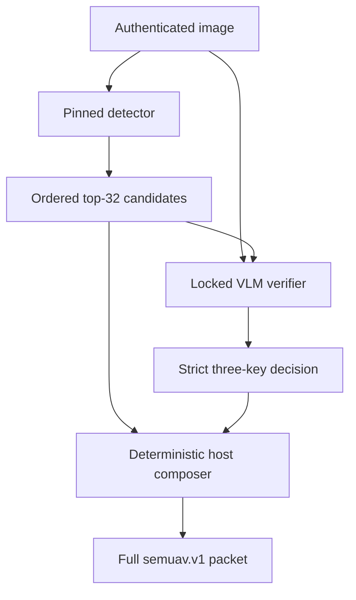

# SemUAV-VLM VisDrone paper study — pre-validation methodology amendment

Date: 2026-09-08  
Amended study ID: `semuav_vlm_visdrone_paper_v2r1`  
Amended run name: `semuav_visdrone_v2r1`  
Decision-contract version: `semuav.visdrone-proposal-decision.v1`  
Packet contract: `semuav.v1`

Release-lineage note: the executable correction that assigns the distinct
v2r1 release, run, cache, environment, and kernel identities is recorded in
`PRE_SMOKE_CORRECTION_20260908.md`. The bounded semantic architecture and every
registered methodological contract in this amendment remain unchanged.

## Amendment status and timing

This amendment was specified before any registered validation or untouched-test
image, annotation, or outcome was read by the v2r1 workflow. No empirical
Experiments 1–7, hypothesis test, model selection, paper table, or publication
figure had been run when the amendment was adopted. The work that motivated it
was restricted to development-only runtime smoke diagnosis on authenticated
study-train material.

The amendment replaces only the model-authored semantic-output interface and
the interpretation of downstream semantic metrics. It does not alter publisher
truth, data partitions, natural-group sampling, network traces, transport
mechanisms, resource budgets, endpoint deadlines, the detector checkpoint, the
L4 feature head, the four model snapshots, or the one-time test-access rule.

The v1 release and its Python environment are retained as historical evidence.
They are not modified to implement this amendment and must not be used to run
the v2r1 notebook.

## Reason for the amendment

The original interface asked each VLM to author a complete 13-field
`semuav.v1` packet. Development smoke showed that both locked Qwen models
reached the registered 384-token output cap before closing the JSON object. A
1024-token diagnostic remained unfinished. A production-shaped diagnostic with
32 detector proposals again reached 384 tokens without EOS. These diagnostics
were development evidence only; they did not access validation or test media or
write scientific results.

The failure was structural: the full packet repeats authoritative request data
and detector geometry, allowing output length to scale with the number of
objects. Increasing the token cap would increase runtime and memory and would
still leave the model responsible for copying fields that should never vary.
The amended interface therefore makes the VLM decision bounded while retaining
the complete `semuav.v1` packet on the wire and in all downstream experiments.

## Amended detector-conditioned inference pipeline

All four locked VLMs use the same interface:

- Qwen3-VL-2B-Instruct;
- SmolVLM2-2.2B-Instruct;
- Moondream2; and
- Qwen3-VL-8B-Instruct, retained as the isolated upper-bound model.

For each observation, the authenticated, pinned detector produces candidates.
The registered proposal policy retains at most 32 candidates with detector
confidence at least 0.05, ordered deterministically by confidence and geometry.
The position in this authenticated, ordered list is the stable `proposal_id`.
It is a zero-based position and is never a detector track ID.

Each VLM receives:

1. the common 768×768 aspect-preserving letterboxed RGB image, followed by its
   pinned native processor; and
2. a compact context containing the contract identifier, source-image size,
   model-input size, letterbox content rectangle, and proposal rows of the form
   `[proposal_id,label,x1,y1,x2,y2]` with source-normalized coordinates.

The model context intentionally omits detector confidence, track IDs, absolute
paths, telemetry, mission profile, registered ROI, authoritative packet fields,
gold labels, actions, and outcomes. Detector proposals are candidates, not
ground truth.



## Exact model-authored contract

The VLM must emit exactly one JSON object with exactly these three keys:

```json
{
  "sufficient_evidence": true,
  "accepted_proposal_ids": [0, 3],
  "limited_visibility_proposal_ids": []
}
```

The parser and schema gate enforce all of the following:

- no prose, Markdown fence, prefix, suffix, or second JSON value;
- no missing, extra, or duplicate key;
- no non-standard JSON constant such as `NaN` or `Infinity`;
- `sufficient_evidence` is a JSON boolean, not an integer or string;
- both ID values are JSON arrays containing integers only; booleans are not
  accepted as integers;
- IDs must refer to supplied proposals, be unique, and be strictly increasing;
- `limited_visibility_proposal_ids` must be a subset of
  `accepted_proposal_ids`;
- `sufficient_evidence=false` requires both arrays to be empty; and
- `sufficient_evidence=true` with empty arrays is valid and means that the image
  is assessable but no supplied proposal is visibly supported.

Generation is greedy with `max_new_tokens=384`. There is no assistant prefill,
schema repair, fence stripping, prose extraction, retry, self-correction,
fallback completion, or substitution of detector output after a VLM failure.
Raw model text is retained for audit. For Hugging Face generation, the decision
must be complete, non-truncated, and terminated by a configured EOS token; EOS
at the last permitted token is valid. The Moondream query API exposes no finish
metadata, so its strictly parsed exact decision is the termination evidence. A
malformed or incomplete response fails that inference record and fails the
required runtime smoke.

## Deterministic host composition

After strict validation, a deterministic host composer creates the complete
`semuav.v1` semantic packet. The VLM does not author localization, telemetry,
relations, event names, actions, risk, or uncertainty.

Each VLM inference record carries the decision-contract version, the exact
decision-context SHA-256, the deterministic composer-policy SHA-256, and
`semantic_packet_authorship=deterministic_host_composer`. These lineage fields
bind a composed packet to the bounded decision and host policy that produced it.

The composer:

- copies `observation_id`, mission, capture time, telemetry, and registered
  mission-profile/ROI inputs from the authoritative request;
- selects only the authenticated detector proposals identified by the VLM;
- copies their exact detector labels, normalized geometry, confidence, and
  track IDs when present;
- derives evidence links from accepted proposal IDs;
- derives image-plane-overlap relations at the unchanged IoU threshold of
  0.05;
- derives event and action using the frozen mission-profile priority classes,
  ROI-center rule, and limited-visibility decision; and
- derives risk and uncertainty deterministically from that event/action state.

For assessable images, event/action precedence is:

1. a non-limited active-priority proposal centered inside the registered ROI:
   `visible_priority_roi_occupancy` / `RESPOND`;
2. otherwise, a limited-visibility active-priority proposal:
   `priority_target_low_visibility` / `REVIEW`;
3. otherwise, an active-priority proposal outside the ROI:
   `visible_priority_outside_roi` / `REVIEW`;
4. otherwise, a registered overlap relation:
   `visible_image_plane_overlap` / `NO_ACTION`; and
5. otherwise: `no_registered_priority_visible` / `NO_ACTION`.

If `sufficient_evidence=false`, the composer emits the frozen insufficient-
evidence packet with `REVIEW`. Limited visibility on a non-priority proposal
does not by itself raise uncertainty. The composed full packet—not the small
three-key decision—is the transmitted semantic payload and is therefore the
object used for wire-byte, latency, energy, and downstream communication
accounting.

## Metric and claim interpretation

All semantic action, event, object, and relation measurements for a VLM route
are measurements of the composed detector + VLM proposal-verifier +
deterministic-composer pipeline. Their machine-readable metric scope is
`composed_detector_verifier_pipeline`. Their selection claim scope is
`detector_proposal_conditioned_end_to_end_pipeline_not_free_form_vlm_generation`.

Accordingly, this study may describe the VLM as verifying or selecting from
detector proposals. It must not describe a VLM as freely extracting all scene
objects, authoring bounding boxes, localizing objects independently, authoring
relations, or generating the complete semantic packet. Authoritative-field
consistency is guaranteed by the host composer; it is not evidence of model
copying accuracy. Detector recall imposes a ceiling on every detector-
conditioned VLM route and must be reported alongside semantic results.

Calibration is fitted again from v2r1 development outputs because the prediction
interface and error meaning changed. No v1 VLM confidence calibration or model
selection result is carried forward. Temperature scaling minimizes
`visual_group_equal_temperature_nll_v1`: each calibration row receives weight
equal to the inverse number of rows in its natural visual group, so every group
contributes equal total weight despite profile expansion or unequal frame counts.

## Amended model-selection estimand

Compact-model selection uses development calibration/validation evidence only.
The registered estimand is
`group_equal_critical_action_plus_object_exact_v2`:

```text
selection_score =
    0.50 * critical_action_accuracy
  + 0.50 * objects_exact_accuracy
```

`objects_exact_accuracy` means exact equality of the object-label multiset,
ignoring geometry, conditional on the frozen detector proposals. It is not a
free-form localization score. Natural visual groups receive equal weight.

Ties are resolved deterministically in this exact order:

1. `selection_score_desc`;
2. `critical_action_accuracy_desc`;
3. `objects_exact_accuracy_desc`;
4. `full_path_latency_p95_ms_asc`; and
5. `model_id_asc`.

The pre-existing eligibility, calibration, latency, memory, schema-validity,
semantic-validity, priority-recall, and gain-over-detector gates remain in
force. Moondream2 remains calibration-ineligible. Qwen3-VL-8B remains an
upper-bound reference rather than a compact deployment candidate.

## Hypothesis consequences

| Hypothesis | v2r1 status and interpretation |
|---|---|
| H1 | The registered estimator and test are unchanged. H1 remains an end-to-end comparison of transmission utility and resource effects for composed semantic packets. It is detector-proposal-conditioned and does not test free-form VLM packet authorship. |
| H2 | The estimator is unchanged and remains structurally `NOT_ESTIMABLE` for the bounded 15-sequence/450-cell temporal campaign. Descriptive controller results retain the amended pipeline labels. |
| H3 | The estimator is unchanged and remains structurally `NOT_ESTIMABLE` because the 15 temporal groups cannot meet the registered positive/negative group minima. Descriptive endpoints retain the amended pipeline labels. |
| H4 | Narrowed to selective action-error reduction for the composed detector-verifier-composer pipeline. The confirmatory endpoint remains conjunctive matched-coverage and high-confidence error reduction with the frozen denominator gates and threshold 0.80. Legacy artifact column names containing `semantic_error` are retained for compatibility but mean composed-pipeline action correctness, not free-form semantic generation. |
| H5 | Unchanged: `NOT_APPLICABLE_NO_TARGET_EVIDENCE` for this RTX 4090 campaign. |

H1 artifacts use claim scope
`end_to_end_transmission_utility_and_resource_effects_for_composed_semantic_packets`.
H4 artifacts use claim scope
`composed_detector_verifier_pipeline_selective_action_error_not_free_form_vlm_semantic_generation`.
Both identify `deterministic_host_composer` as semantic-packet author and set
free-form VLM packet-authorship claim eligibility to false.

## Reused immutable evidence

The v2r1 workflow reuses, by read-only reference, work completed before this
amendment. It does not retrain the detector, retrain the L4 head, rebuild the
development bundle, or redownload model snapshots. Before the v2r1 smoke, it
writes `REUSED_V1_FROZEN_ARTIFACTS.json` from a deliberately restricted
inventory: the registered train sample, model lock/snapshots, detector
checkpoint and anchored training receipts, and train-only L4 feature-head
artifacts. It does not open or hash the prepared development bundle or any
registered calibration/validation sample at this gate. The receipt records that
the full development-bundle verification is deferred until after the successful
four-model smoke and scientific-use environment seal. Every byte admitted to
the pre-seal inventory is verified against the following anchors:

| Reused item | Frozen identity |
|---|---|
| v1 frozen-input root | `/data/Lane Detection Datasets/musta/semuav_vlm/outputs/visdrone_paper/semuav_visdrone_v1/frozen_inputs` |
| Model-lock JSON | `aa7b6cc93c7783714ca5b1f1f80a776567078771db4d73ad92de941bde0c3de8` |
| Detector checkpoint | `a66356321ca834056f7945ecba2c121a6021999796beb0969e2e34232d79902a` |
| Detector-training receipt | `e2f0349115b4749faaeb0b04a8b7eee3e1d01a94649743ef6d127966c8795fe7` |
| Detector-training environment fingerprint | `87cb1b1bdd7e98a9eb59853fcbc91bc4cf22235675017427cab293d4437eb4a4` |
| Detector-training `pip freeze --all` | `b9d550396e7d037d03d57ed9ecaf62a4b4e76f761760766e6a4beb63186fb825` |
| Detector-training plan | `949ab79ce4d067edb8d550ea5f57a945ebb5ea832682c44ec0fa4c20794d1031` |
| L4 feature-head lock | `83b99ec9435825443c2e111bc01908332f11828742d093926ecf86b2588d3068` |
| Registered train sample | `f6d852e940f7968dea908180c0f32ca8229852287cc23ae2f7ff72dfc70dae6f` |
| Registered train sampling audit | `3614e8dc586d016b89dca0edfaa392f3196723e53a921b5e170f2d3bfb984621` |

Individual model commits and complete snapshot-file hashes remain those inside
the verified `MODEL_LOCK.json`; the v2r1 notebook resolves and enforces them from
that artifact rather than copying mutable model names. For traceability, the
known locked Qwen revisions are
`89644892e4d85e24eaac8bacfd4f463576704203` for Qwen3-VL-2B and
`0c351dd01ed87e9c1b53cbc748cba10e6187ff3b` for Qwen3-VL-8B. The lock file is
authoritative for all four models.

## Environment separation and provenance

The historical environment
`/data/Lane Detection Datasets/musta/semuav_vlm/venvs/release_20260830`
was changed after its frozen inventory when Ultralytics automatically installed
`lap==0.5.13` during a development diagnostic. The audited frozen and current
package-inventory hashes differ. That environment is therefore forensic-only:
do not uninstall packages from it, repair it in place, launch Jupyter from it,
or use it for v2r1 inference.

Compatibility testing occurs in the fresh sibling candidate environment
`/data/Lane Detection Datasets/musta/semuav_vlm/venvs/release_20260908_visdrone_inference_candidate_v2r1`.
Its `SEMUAV_CANDIDATE_READY.json` status is
`READY_FOR_DEVELOPMENT_SMOKE_ONLY`; it does not authorize scientific results.
The candidate pins the compatibility stack, including Torch 2.7.0 with CUDA
12.8, torchvision 0.22.0, Transformers 4.57.1, tokenizers 0.22.1,
huggingface-hub 0.36.0, Ultralytics 8.4.135, `lap==0.5.13`,
`accelerate==1.14.0`, `num2words==0.5.14`, and `docopt==0.6.2`.

Only after all four locked models pass the production-shaped smoke can that
exact successful inventory be sealed in place as the v2r1 scientific inference
environment. Its required Python remains
`/data/Lane Detection Datasets/musta/semuav_vlm/venvs/release_20260908_visdrone_inference_candidate_v2r1/bin/python`;
it is not renamed or copied after smoke. It is registered under kernelspec
`semuav-vlm-20260908-v2r1`, displayed as
`Python (SemUAV-VLM 2026-09-08 v2r1)`. The v2r1 workflow writes separate
`INFERENCE_ENVIRONMENT_FINGERPRINT.json` and `INFERENCE_PIP_FREEZE.txt` files.
The historical `ENVIRONMENT_FINGERPRINT.json` and `PIP_FREEZE.txt` remain
detector-training evidence and are never rewritten.

After the 4/4 result verifies and a post-smoke fingerprint confirms no import-
time package mutation, the prepare phase atomically writes
`INFERENCE_ENVIRONMENT_SEAL.json` with schema
`semuav.visdrone-inference-environment-seal.v1` and status
`SEALED_FOR_SCIENTIFIC_VALIDATION_AND_TEST`. The seal binds the original
development-only candidate-ready receipt, Python executable and prefix,
inference runtime and installed name/version `pip freeze --all` hashes, smoke
input/result hashes, reused-v1 receipt, source/config identities, and exact
runtime guards. This exact name/version freeze and runtime fingerprint plus 4/4
smoke is the scientific-use seal. The downloaded wheel files are not
hash-locked, and a wheelhouse is not an additional registered methodological
requirement. Validation first verifies the complete seal, then verifies and
loads the full frozen development bundle and the calibration/validation
registered-sample manifests. Test verifies the complete seal before opening its
restricted data.

Scientific phases additionally require:

```text
YOLO_AUTOINSTALL=false
PIP_NO_INDEX=1
PIP_NO_INPUT=1
HF_HUB_OFFLINE=1
TRANSFORMERS_OFFLINE=1
SEMUAV_MODELS_LOCAL_ONLY=1
```

The operational bootstrap also sets `PYTHONDONTWRITEBYTECODE=1` so tests and
Jupyter do not add `__pycache__` files to the frozen release source.

## Gate to validation and untouched test

The production-shaped smoke uses a hash-bound study-train canary and exactly 32
authenticated detector proposals. Its input receipt is
`MODEL_RUNTIME_SMOKE_INPUT.json`; its four-model result is
`MODEL_RUNTIME_SMOKE.json`. Every registered model must have exactly one `PASS`
row bound to the expected request, image, proposal inventory, prompt/contract,
model ID, revision, and raw output. A missing row, exception, malformed JSON,
schema failure, identity mismatch, or hash mismatch blocks the study.

No validation or test image, annotation, or outcome may be read before all of
the following are true:

1. the v2r1 release source and acceptance tests pass;
2. the restricted train/model/detector/feature pre-seal inventory verifies
   against `REUSED_V1_FROZEN_ARTIFACTS.json` without reading validation-derived
   artifacts;
3. the clean inference environment is fingerprinted and package-locked;
4. the production-shaped runtime smoke is `PASS` for all four locked models;
5. `INFERENCE_ENVIRONMENT_SEAL.json` has status
   `SEALED_FOR_SCIENTIFIC_VALIDATION_AND_TEST` and matches every bound byte;
6. the final scientific kernelspec resolves to that exact environment; and
7. the notebook's validation gate verifies all of those receipts again, and
   only after the seal passes does it open and verify the complete development
   bundle and registered validation sample.

The one-time test remains additionally blocked until validation completes,
selection/calibration are reviewed, the v2r1 protocol is frozen, its evidence is
backed up, and the explicit one-time OPEN authorization is given. The test is
never used as a smoke check.

## Required paper language

Methods, tables, figures, captions, and discussion must use language equivalent
to “detector-conditioned VLM proposal verifier with deterministic semantic-packet
composition.” They must distinguish the tiny model-authored decision from the
full transmitted `semuav.v1` packet. Any comparison involving the VLM route is
an end-to-end pipeline comparison conditional on the frozen detector proposal
set. Limitations must include the detector recall ceiling and the absence of a
free-form VLM localization or packet-authorship claim.

This amendment must be cited with the frozen v2r1 configuration, source manifest,
inference-environment receipts, reuse receipt, smoke input/result receipts, and
final protocol. Those artifacts together define the amended executable method.
